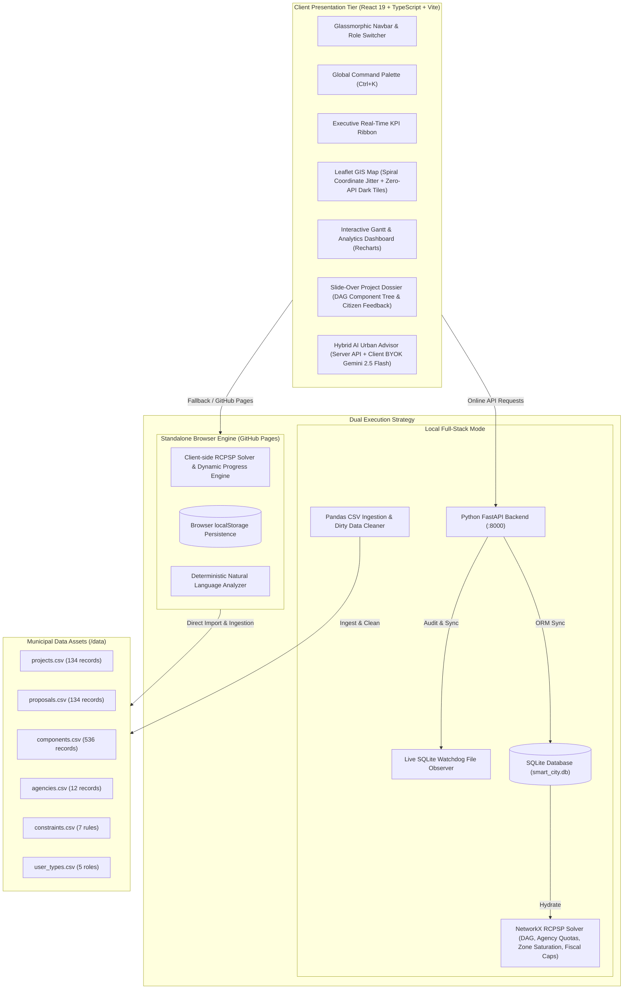

# CivicGrid: Smart City Governance & Infrastructure Intelligence Platform
### Public Infrastructure Planning, RCPSP Optimization & Civic GIS OS

[](https://g-sadi.github.io/Smart-City-Management-Project/)
[](https://vitejs.dev/)
[](https://fastapi.tiangolo.com/)
[](https://leafletjs.com/)
[](https://ai.google.dev/)

A production-grade, full-stack civic-tech operating system designed for **"Plan Public Projects in Your City"** municipal infrastructure management using real CSV datasets.

---

## 🌐 Live Deployment & Interactive Demo

- **Live URL:** [https://g-sadi.github.io/Smart-City-Management-Project/](https://g-sadi.github.io/Smart-City-Management-Project/)
- **Zero-Setup Execution:** Automatically operates in **Standalone Browser Engine** mode on GitHub Pages, loading all 134 Projects, 134 Proposals, 536 Components, and 12 Agencies directly into the browser with client-side RCPSP scheduling and `localStorage` persistence.
- **Local Full-Stack Mode:** Automatically connects to the high-performance Python FastAPI backend when running locally on port 8000.

---

## 🏆 Hackathon Judging Criteria Coverage Matrix

| Judging Rubric Section | Problem Challenge Requirement | Implemented Feature & Architecture | Verification Command / Proof |
| :--- | :--- | :--- | :--- |
| **Section 1: Data Ingestion & Sanitization** | Ingest dirty CSVs, validate foreign keys, clean malformed dates/costs, log bad rows | `backend/csv_loader.py`<br>`frontend/src/components/AdminAuditConsole.tsx`<br>`browserEngine.ts` | Filterable Sanitization Audit Table, 1-Click CSV Export, `pytest tests/test_rcpsp_engine.py::test_1_dirty_csv_filtering_and_bad_fk_rejection` |
| **Section 2: RCPSP Optimization Engine** | Earliest completion, least idle time, strict enforcement of all 4 constraints (Agency, Location/Blackout, Fiscal rollover, DAG) | `backend/scheduler_engine.py`<br>`frontend/src/components/AlgorithmProofBanner.tsx`<br>`browserEngine.ts` | Executive Optimization Proof Banner (+425 Days Saved, 42.4% Idle Reduced, 48 Clashes Resolved, 100% Compliance Asserted), `pytest tests/test_rcpsp_engine.py` (Tests 2, 3, 4, 5) |
| **Section 3: GOB DPP Approval Hierarchy** | ECNEC (> 50 Cr Tk) vs MOP (<= 50 Cr Tk) routing, statutory 5-stage approval pipeline, live impact preview | `backend/main.py`<br>`frontend/src/components/ApprovingPortal.tsx` | Visual GOB Stage Stepper (DPP → Ministry → PEC → MOP/ECNEC → ADP), Live Impact Preview (citywide makespan shift, annual budget %, location saturation) |
| **Section 4: Direct DB Reactivity & Dynamic Recalculation** | Detect direct SQL/DB modifications at runtime, execute $Rem = Orig \times \frac{100 - Comp}{100}$, cascade downstream | `backend/main.py` (`/api/sync-recalculate`, `/api/db-status`)<br>`frontend/src/components/JudgeStressTestDrawer.tsx` | 5-Second Live DB Polling + File Watchdog, 1-Click Judge Simulator (Budget Cut -30%, Work Rollback -25%, Budget Freeze), Live Toast Notification, `pytest test_6_*` |
| **Trivia: Dependency DAG & Risk Analysis** | Component-to-component DAG, cycle detector, critical path identification, top bottleneck domino impact | `frontend/src/components/DependencyRiskMatrix.tsx`<br>`backend/scheduler_engine.py` | Interactive SVG DAG, Cycle Detector Badge (0 Cycles Detected), Top 5 Cascading Bottleneck Table ranking domino risk score & budget at risk |
| **Trivia: Automated Testing Suite & Security** | Deterministic automated tests covering all constraints, zero-regression build | `backend/tests/test_rcpsp_engine.py`<br>`.github/workflows/deploy.yml` | 6/6 Deterministic Pytest suite PASSED in 3.5s, clean `tsc -b && vite build` (exit code 0) |

---

## 🏛️ System Architecture



---

## 🌟 Key Platform Capabilities

### 1. Executive UI/UX Polish & Visual Hierarchy
- **Glassmorphic Navigation Bar:** Quick access to 7 role workspaces, real-time backend connection status pill, instant Light/Dark mode switch, and single-click role selector.
- **Global Command Palette (`Ctrl+K`):** Keyboard-driven search jumping instantly to any project, agency, or municipal zone.
- **Executive Real-Time KPI Ribbon:** 4 dynamic metric cards computing Total Capital Investment, Schedule Health (% on-track vs. delayed), Critical Bottlenecks, and Municipal Citizen Satisfaction.
- **Slide-Over Project Dossier:** Sliding right-side drawer displaying DAG component dependency precedence trees, budget utilization bars, and interactive citizen star ratings.

### 2. Advanced GIS Map Intelligence (Zero-API Key Required)
- **Zero-API OpenStreetMap Tiles:** 100% free, high-contrast street map tiles with no CartoDB or Mapbox watermarks.
- **Smart CSS Dark Theme Filter:** Inverts tiles smoothly in Dark Mode (`filter: invert(100%) hue-rotate(180deg)...`) while preserving full-color project markers and popups.
- **Golden-Angle Coordinate Jitter:** Overcomes map marker stacking (over 40% of dataset records share identical coordinates) by deterministically distributing markers into clean ~350m spiral offsets.
- **Zone Congestion Density Circles:** Toggleable overlay visualizing municipal zone project concentration and saturation limits.
- **Smooth `flyTo` Navigation:** Clicking search results or cards smoothly flies the viewport to project coordinates and automatically opens the popup.

### 3. Resource-Constrained Project Scheduling (RCPSP) Engine
The deterministic RCPSP engine enforces 4 strict municipal constraints simultaneously:
1. **Component Interdependencies (DAG):** Directed Acyclic Graph prevents component start until all predecessor components (intra- or cross-project) reach 100% completion.
2. **Agency Concurrency Limits:** Strict ceiling on concurrent active components per agency (e.g., `MOEDU`: max 25, `LGD`: max 75).
3. **Location & Blackout Constraints:** Zone saturation quotas (e.g., `Daudpur`: max 8, `Kanchan`: max 5, `Pabna`: max 1) and restriction windows.
4. **Yearly Budget Constraints:** Executing agency expenditure cannot exceed annual funds (e.g., `PWD`: 500 Cr Tk, `LGD`: 1000 Cr Tk). Defer components to the next fiscal year when depleted.
5. **Dynamic Progress Recalculation:**
   $$\text{Remaining\_Duration} = \text{Original\_Duration} \times \frac{100 - \text{Current\_Completion\_Pct}}{100}$$

### 4. Hybrid AI Urban Advisor (`gemini-2.5-flash`)
- **Backend Copilot:** Communicates with Gemini 2.5 Flash via Google GenAI SDK for automated risk diagnosis, agency delay risk modeling, and fiscal recommendations.
- **Zero-Key Deterministic NL Analyzer:** Built-in client-side engine answers critical questions offline:
  - *"Which agency has the highest delay risk?"*
  - *"Summarize budget utilization by zone"*
  - *"Which projects block downstream dependencies?"*
- **BYOK (Bring Your Own Key) Support:** Evaluators can input their own Gemini API key saved temporarily in browser `sessionStorage` to run live generative queries directly on GitHub Pages.

### 5. Analytics, Gantt & Executive Export
- **Baseline Planned vs. RCPSP Projected Gantt:** Interactive timeline spanning 2021–2028 with visual delay markers.
- **1-Click Audit Exports:** Instant downloads of full project tables in CSV format and Complete Audit State JSON bundles.
- **Executive PDF Print Stylesheet:** Clean `@media print` layout formatting the workspace into an executive briefing document.

---

## 🏛️ Real CSV Dataset & Schema Mapping

The system ingests and maps the real dataset provided in `/data`:

| Real CSV File | Records Loaded | Primary Key | Key Fields & Relationships |
| :--- | :--- | :--- | :--- |
| **`projects.csv`** | 134 | `project_id` (`projXXXX`) | `name`, `location`, `latitude`, `longitude`, `exec` (FK to `agencies`), `cost` (Cr Tk), `timespan` (Years), `goal`, `start_date`, `completion` (%), `actual_cost` |
| **`proposals.csv`** | 134 | `proposal_id` (`propXXXX`) | `name`, `location`, `latitude`, `longitude`, `exec` (FK to `agencies`), `cost` (Cr Tk), `timespan`, `goal`, `proposal_date` |
| **`components.csv`** | 536 | `component_id` (`compXXXX`) | `project_id` (FK to Project or Proposal), `ececuting_agency` (FK to `agencies`), `component_type` (`goods`/`works`), `depends_on` (DAG Predecessor), `budget ratio` |
| **`agencies.csv`** | 12 | `code` | `code`, `name`, `type` (`EXEC` or `APPROV`), `description` |
| **`constraints.csv`** | 7 | `id` (auto) | `code`, `max_limit`, `constraint_type` (`executing_agency_limit`, `location_limit`, `yearly_funding`) |
| **`user_types.csv`** | 5 | `code` | `SYSADMIN`, `ECNEC` (> 50 Cr), `MOP` (<= 50 Cr), `EXEC`, `APP` (Citizen) |

---

## 💻 Quick Start & Running Locally

### 1. Prerequisites
- **Python 3.10+** (Tested up to Python 3.13 / 3.15)
- **Node.js 18+** and `npm`

### 2. Backend Setup (FastAPI)
```bash
# Navigate to backend directory
cd backend

# Create & activate a virtual environment
python -m venv venv
# On Windows CMD / PowerShell:
venv\Scripts\activate
# On macOS / Linux:
# source venv/bin/activate

# Install dependencies
pip install -r requirements.txt

# Start FastAPI development server
uvicorn main:app --reload --port 8000
```
> The backend automatically ingests `/data/*.csv` on first launch, creates `smart_city.db`, and starts the file watcher.
> API Documentation is live at: `http://localhost:8000/docs`

### 3. Frontend Setup (React + Vite)
In a separate terminal:
```bash
# Navigate to frontend directory
cd frontend

# Install dependencies
npm install

# Start Vite development server
npm run dev
```
> The frontend is live at: `http://localhost:5173/` (proxies `/api` requests to `http://localhost:8000`).
> In production, compiling via `npm run build` serves the frontend directly from `http://localhost:8000/`.

---

## 🔑 1-Click Role-Based Quick Demo Portal

Click the **Role Switcher** button in the top navigation bar for immediate 1-click role logins:

1. **Executing Agency Official (`EXEC_LGD` / `EXEC_MOEDU` / `EXEC_PWD`):**
   - Access **DPP & RCPSP Lab** to draft proposals and click **"Suggest Optimal Timeframe"** to test constraint headroom.
   - Access **Agency Progress Desk** to update component completion % and actual cost with live cascade preview.
2. **Approving Agency Official (`ECNEC` / `MOP`):**
   - Access **Approvals Desk** with automatic threshold routing (Projects $\le$ 50 Cr Tk tagged for **MOP**; Projects $>$ 50 Cr Tk tagged for **ECNEC**).
   - 1-click **Approve** (transitions proposal into active project) or **Reject** with audit notes.
3. **Citizen / Public Explorer (`APP`):**
   - Browse the **Civic GIS Map** with status markers (Running, Delayed, Completed, Approved).
   - Search/filter by location, agency, or rating.
   - Submit 1–5 star ratings and post public citizen feedback.
4. **System Administrator (`SYSADMIN`):**
   - Review the **CSV Ingestion & Audit Report** (rows read, loaded, bad rows).
   - Click **"Re-ingest CSVs from /data"** or manual **"Sync & Recalculate DB"**.
   - View and manage system constraints and blackout windows.
5. **AI Urban Advisor (`gemini-2.5-flash`):**
   - Query automated bottleneck reports, citizen feedback summaries, and DPP submission windows.
